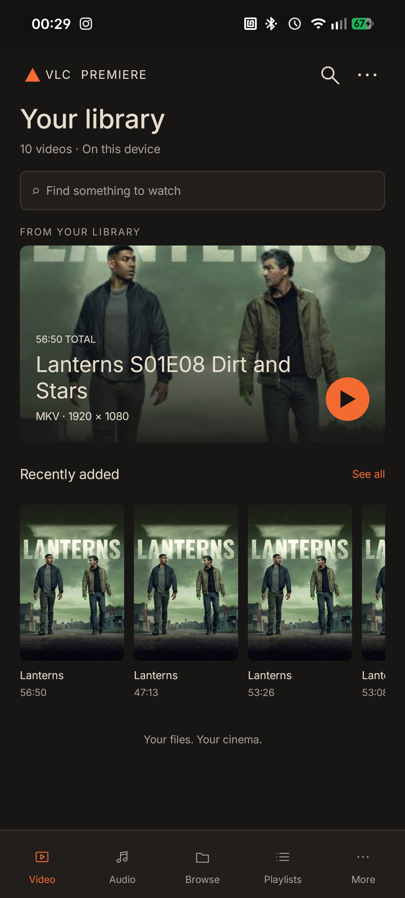
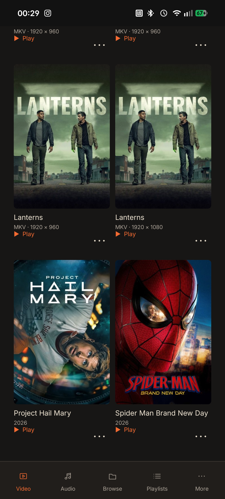
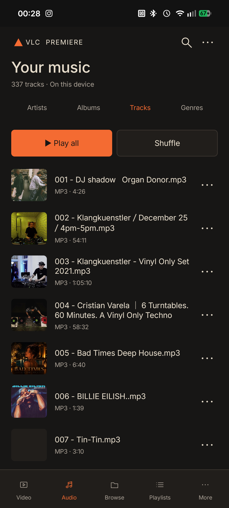

# VLC Première for Android

VLC Premiere is a native Android redesign of VLC's phone interface, built over the retained VLC 3.7.1 media engine. It brings a focused video and audio library, artwork, playback controls, and the familiar VLC media support into a phone-first experience.

[Download the packaged release](https://github.com/benclawbot/VLC-Premiere/releases/tag/premiere-2026.10.11) · [ARM64 APK](https://github.com/benclawbot/VLC-Premiere/releases/download/premiere-2026.10.11/VLC-Premiere-arm64.apk) · [Universal APK](https://github.com/benclawbot/VLC-Premiere/releases/download/premiere-2026.10.11/VLC-Premiere-Universal.apk)

Artwork searches start automatically after VLC discovers media, using both filenames and tags with fuzzy matching. Music covers use MusicBrainz, Deezer and matching YouTube thumbnails; movie/TV posters use a personal TMDB read token entered in **More → Settings → Artwork**. Images are cached privately on the phone. Catalogue coverage and match accuracy vary.

## Screenshots

Captured directly from the signed release installed on Nothing A001 / Android 16. [Capture details](android-premiere/previews/phone/capture.json).

| Video library | Movie posters | Audio library |
| --- | --- | --- |
|  |  |  |

## Install

The release provides two APKs:

- **ARM64** for most current Android phones.
- **Universal** for ARM64, ARMv7, x86, and x86_64 devices.

Android 11 or later is required. Install the APK as an update to an existing Premiere installation to retain its private preferences and saved TMDB token. Uninstalling the app or clearing its data removes that information. Both APKs and [SHA256SUMS](https://github.com/benclawbot/VLC-Premiere/releases/download/premiere-2026.10.11/SHA256SUMS) are attached to the release. The packages use the existing Premiere development certificate and package ID `org.videolan.vlc`; they update previous Premiere builds signed with that certificate.

## Build from source

Requires Python 3, Java 17, Apktool 3.0.3, and the Android API 30 platform `android.jar`. The build-tools and original VLC APKs are fetched and checksum-verified; the Apktool jar and Android platform jar are supplied separately. Configure Java with `JAVA_HOME`, or place a JDK in `android-premiere/tools/jdk` or on `PATH`. Set `APKTOOL_JAR` to the Apktool 3.0.3 jar, or place it at `android-premiere/tools/apktool.jar`. Place the API 30 platform jar at `android-premiere/tools/android.jar` (for example, copy it from `$ANDROID_SDK_ROOT/platforms/android-30/android.jar`).

From the repository root:

```sh
python3 android-premiere/scripts/fetch_dependencies.py
bash android-premiere/scripts/build.sh
```

Preparation uses an existing root decoded smali tree when present. On a fresh checkout, it verifies and decodes the fetched original ARM64 APK into the ignored `android-premiere/baseline/` cache. The build script then runs resource and native UI patching, APK compilation, and signing. Missing Java or Apktool paths produce setup instructions. The signing certificate and password are generated locally under the ignored `android-premiere/signing/` directory; preserve that directory to produce update-compatible builds. It is a local development certificate and cannot update an official VLC installation.

See [the Android implementation README](android-premiere/README.md) for implementation details and [verification notes](android-premiere/VERIFICATION.md) for recorded build and handset checks. The native source and build scripts are under [`android-premiere/`](android-premiere/).

## Design and baseline

The [selected Premiere proposal](design-proposals/premiere/README.md), [Cinema variations](design-proposals/cinema/README.md) and [original proposals](design-proposals/README.md) are retained alongside the implementation. The original decoded-resource inventory is preserved in [the baseline report](docs/DECOMPILED-BASELINE.md). VLC engine dependencies and their checksums are recorded in [DEPENDENCIES.json](android-premiere/DEPENDENCIES.json).
